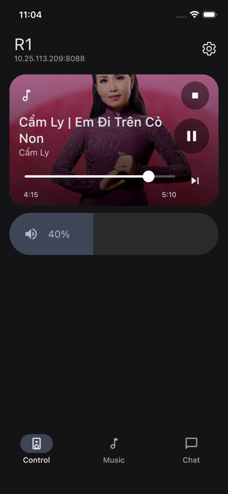
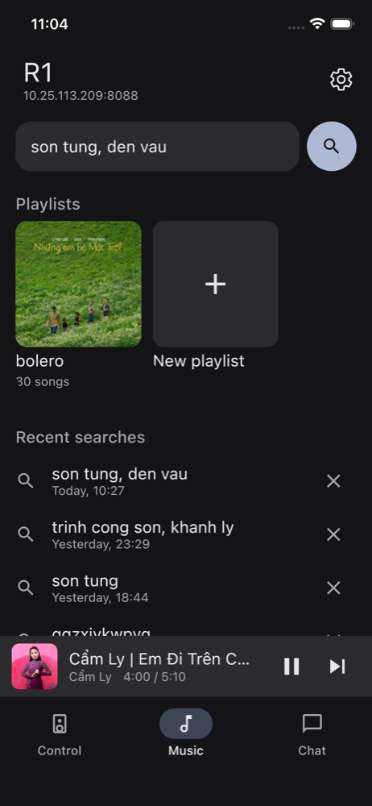
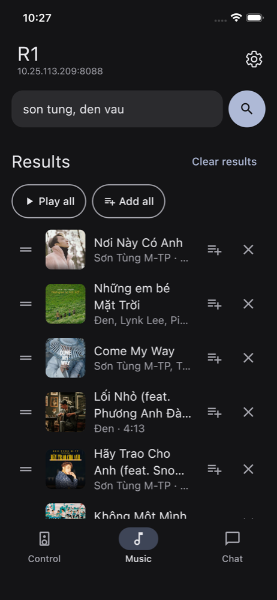
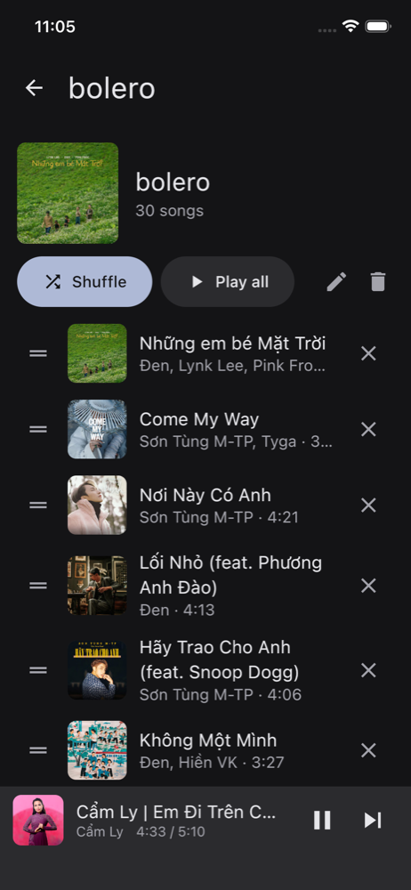
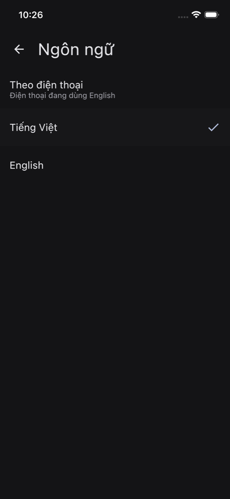

# R1 Control

A phone remote for a Phicomm R1 speaker running [xiaozhi-android](https://github.com/kuteo-git/xiaozhi-android). Android and iOS, built with Kotlin Multiplatform and Compose Multiplatform.

[English](#english) · [Tiếng Việt](#tiếng-việt)

| Control | Music | Results | Playlist | Language |
|---|---|---|---|---|
|  |  |  |  |  |

---

## English

R1 Control talks to the control server the R1 already runs (`http://<speaker>:8088`). It needs no account, no cloud and no server of its own. The phone and the speaker must be on the same wifi.

### What it does

- **Control.** Shows what the speaker is playing, with play and pause, Next, seek, stop and volume.
- **Music.**
  - Search for several songs or artists at once, separated by commas (`son tung, den vau`).
  - Tap a row to play the list from it.
  - Drag a row by its handle to reorder the list, or tap its X to remove a song.
  - Edits never cut the song that is playing. They reach the speaker at the next Next.
- **Playlists, kept on the phone.**
  - Create, rename and delete them.
  - Add one song from its row, or every result with "Add all".
  - A playlist's page has Shuffle, Play all, drag to reorder and X to remove.
- **Mini player.** It appears on every tab and every music page, with Next and the time.
- **Chat.** Type to the assistant instead of speaking to it.
- **Settings.**
  - Audio: loudness and equalizer.
  - Voice.
  - The daily news bulletin, with categories ordered by drag.
  - Bluetooth: play to a Bluetooth speaker, or play from your phone.
  - Language: follow the phone, Tiếng Việt or English.
  - The speaker's address.
- **Listening controls.** A wake-word switch, and "End the conversation" while the speaker is listening. They show only when the speaker runs an xiaozhi-android build that reports `wake_enabled`. With an older build, nothing is drawn.

### Install

Download from [Releases](../../releases):

- **Android.** Install `R1Control-<version>.apk`.
- **iOS.** Install `R1Control-<version>.ipa` with AltStore or Sideloadly. The installer signs it with your Apple ID.

On first launch, type the speaker's address, for example `192.168.1.20`. The app checks that the address answers like an R1 before it saves it. On iOS, allow Local Network access when asked.

### Build from source

All of the toolchain lives on an external volume, so `env.sh` points at the JDK, the Android SDK, Gradle and Kotlin/Native.

```sh
source env.sh
./gradlew jvmTest :composeApp:compileDebugKotlinAndroid :composeApp:compileKotlinIosSimulatorArm64   # tests + both compiles
./gradlew :composeApp:assembleRelease     # APK; signed when keystore.properties exists, unsigned otherwise
tools/ios-ipa.sh                          # IPA in dist/
```

Pinned versions: Kotlin 2.3.20, Compose Multiplatform 1.11.0, AGP 8.11.1 and Ktor 3.5.2. `gradle/libs.versions.toml` explains each pin.

### How it is built

- **Clean architecture.** `domain` imports no HTTP, serialization or Compose. `ArchitectureGuardTest` fails the build when a dependency points the wrong way.
- **One shared reading of the speaker** (`SpeakerFeed`), polled only while the app is on screen. Every screen draws from it.
- **One owner for every song list** (`MusicStore`). The playing list is a pointer into it, never a copy, and there is one Next, guarded by `OneNextGuardTest`.
- **Every word on screen** goes through a `Strings` interface. A missing translation does not compile.
- 532 tests, including real-pointer drag tests rendered with `ImageComposeScene`.

`CLAUDE.md` is the project charter, and `docs/spec.md` is the product spec.

---

## Tiếng Việt

R1 Control là app điều khiển loa Phicomm R1 đang chạy [xiaozhi-android](https://github.com/kuteo-git/xiaozhi-android). App có bản cho cả Android và iOS, viết bằng Kotlin Multiplatform và Compose Multiplatform.

App nói chuyện thẳng với control server có sẵn trên loa (`http://<loa>:8088`). Không cần tài khoản, không cần cloud, cũng không cần server riêng. Điện thoại và loa chỉ cần chung một mạng wifi.

### Tính năng

- **Điều khiển.** Xem loa đang phát gì. Có phát/tạm dừng, chuyển bài, tua, dừng và chỉnh âm lượng.
- **Nhạc.**
  - Tìm nhiều bài hoặc nhiều ca sĩ cùng lúc, ngăn nhau bằng dấu phẩy (`son tung, den vau`).
  - Chạm vào một bài để phát cả danh sách từ bài đó.
  - Giữ tay cầm ở đầu dòng rồi kéo để đổi thứ tự. Bấm X để xoá bài.
  - Sửa danh sách không làm ngắt bài đang phát. Thay đổi sẽ áp dụng từ lần bấm chuyển bài tiếp theo.
- **Playlist lưu trên điện thoại.**
  - Tạo, đổi tên và xoá playlist.
  - Thêm từng bài ngay trên dòng của bài đó, hoặc thêm cả kết quả tìm bằng "Thêm tất cả".
  - Trang playlist có Phát ngẫu nhiên, Phát tất cả, kéo để đổi thứ tự và X để xoá bài.
- **Mini player.** Hiện ở mọi tab và mọi trang nhạc, có nút chuyển bài và thời gian.
- **Trò chuyện.** Gõ chữ cho trợ lý thay vì nói.
- **Cài đặt.**
  - Âm thanh: độ lớn và EQ.
  - Giọng đọc.
  - Bản tin hằng ngày. Kéo để sắp thứ tự các mục tin.
  - Bluetooth: phát ra loa Bluetooth, hoặc nhận nhạc từ điện thoại.
  - Ngôn ngữ: theo điện thoại, Tiếng Việt hoặc English.
  - Địa chỉ loa.
- **Nghe.** Công tắc từ đánh thức, và nút "Kết thúc trò chuyện" khi loa đang nghe. Hai nút này chỉ hiện khi loa chạy bản xiaozhi-android có báo `wake_enabled`. Với bản cũ, app không vẽ hai nút này.

### Cài đặt

Tải ở mục [Releases](../../releases):

- **Android.** Cài file `R1Control-<version>.apk`.
- **iOS.** Cài file `R1Control-<version>.ipa` bằng AltStore hoặc Sideloadly. Trình cài sẽ ký app bằng Apple ID của bạn.

Lần đầu mở app, nhập địa chỉ loa, ví dụ `192.168.1.20`. App sẽ kiểm tra địa chỉ đó có đúng là loa R1 rồi mới lưu. Trên iOS, hãy cho phép quyền Mạng cục bộ khi được hỏi.

### Build từ mã nguồn

Xem phần [Build from source](#build-from-source) ở trên. Các lệnh giống hệt nhau.

`CLAUDE.md` là hiến chương của dự án, còn `docs/spec.md` là đặc tả sản phẩm.
